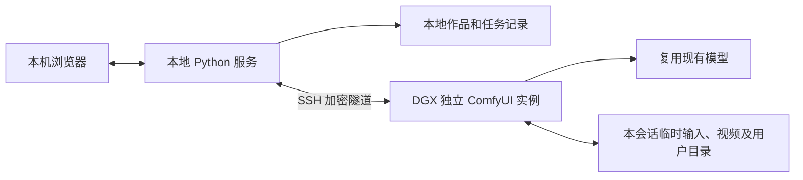

# 本地 AIGC 工作台：初始检查与方案存档

本文记录实现之前的现场检查，部分“待实现”内容现已完成。当前用法和验证结果见项目根目录 README.md。

检查日期：2026-10-14。目标是本地网页负责提示词、上传、进度和图片／视频展示，服务器负责推理，个人输入、作品和历史尽量只在本地长期保存。

推荐先用 **本地网页 + 本地 Python 服务 + SSH 隧道 + DGX 上独立的临时 ComfyUI 实例**。复用已有模型和 Python 环境，从 MiniMax H3 图生视频、参考图生视频开始。

这里的承诺应是“尽量不在服务器持久保存任务内容”。共享服务器管理员、同一 Linux 账号使用者、系统 swap 和审计机制，使“完全不留痕、别人无法看到”无法由这个应用保证。

**现场检查结果**

| 项目 | 实际情况 | 对方案的影响 |
| --- | --- | --- |
| 本地目录 | `D:\aigc` 检查时为空 | 可以建立一个轻量项目，无需兼容旧前端 |
| SSH | `dgx`、`4090` 均可非交互连接 | 可以复用 Windows OpenSSH 和现有密钥配置 |
| DGX | 主机 `spark-b34f`，NVIDIA GB10，约 121 GiB 系统可见统一内存 | 是 DGX Spark；不能按多张独立大显存 GPU 的 DGX 估算性能 |
| DGX 即时负载 | 采样时 GPU 利用率 0%，内存 available 约 114 GiB | 只是检查时的快照，实际任务前须重新查看 |
| ComfyUI | `/home/jnu/src/ComfyUI`，检查时无运行进程／8188 服务 | 需要按需启动实例 |
| Python 环境 | `/home/jnu/venvs/comfyui-ltx23`，Python 3.12.3、PyTorch 2.11.0 | 环境名称含 LTX，但已有 MiniMax H3 支持 |
| 现有代码版本 | Git HEAD `a8686f2`，2026-09-18；存在本地脚本／修改 | 不应擅自升级、覆盖或重装 |
| MiniMax H3 | 图生视频与参考图生视频脚本引用的模型文件均存在 | 可复用工作流结构；仍需实际启动和小任务验证 |
| 已有输出 | `output/video/MiniMax_H3_00001_.mp4`，约 855 KiB，864×480，5.167 秒，H.264 + AAC | 已有视频样本；不能据此推断当前代码一定仍可运行 |
| 视频元数据 | 上述 MP4 含 `prompt` 和 `workflow` 标签 | 文件本身可能带提示词和完整工作流 |
| ComfyUI 用户目录 | 存在工作流、`comfyui.db`、数据库备份和锁文件；主库资产表为空 | 除 input/output，还要隔离 user、数据库及其备份 |
| RTX 4090 | 24 GiB 显存；采样时使用约 4.1 GiB、GPU 利用率 90% | 当前有其他负载；不要只看剩余显存判定空闲 |
| swap | DGX 16 GiB swap，4090 2 GiB swap，均已启用 | 内存中的内容也可能被换出到磁盘 |
| DGX `/dev/shm` | 约 61 GiB 的 tmpfs；挂载参数没有 `noswap` | 适合短期文件，但不等于严格禁止落盘 |

远端检查只读取安装、代码、文件信息和视频元数据，没有启动推理、变更配置或删除旧内容。4090 的有限目录扫描未找到 ComfyUI，尚未做完整安装盘点或推理兼容性验证。

**方案比较**

| 方案 | 优点 | 局限 | 建议 |
| --- | --- | --- | --- |
| SSH 转发后直接打开 ComfyUI | 最快能用，支持完整节点编辑 | 上传、工作流和输出仍可能写在服务器；界面复杂 | 留作开发调试入口 |
| 本地简洁网页 + 独立 ComfyUI 临时实例 | 复用已有 H3 模型；前端可控制内容保存和任务清理 | 需要本地服务及远端会话管理；不保证系统级不落盘 | 第一版采用 |
| 自定义内存输入／视频输出节点 | 可进一步减少应用层临时文件 | 需维护上传解码、编码、音视频同步、流控和重连；swap 与管理员问题仍存在 | 后续确有需要再做 |

当前代码已有 `SaveImageWebsocket` 示例，可以通过 WebSocket 返回完整图片且不保存图片文件。它不是视频流输出节点，也没有解决参考图上传的临时文件问题，因此不能直接拿来宣称 H3 视频已经可以全程无文件运行。

**推荐结构**



第一版用 FastAPI + 简单 HTML/CSS/JavaScript 即可，避免为了几个输入框和播放器先搭建庞大前端。浏览器和本地服务都只绑定本机；SSH 密钥交给 OpenSSH，前端不接触密钥。

本地服务负责建立隧道、启动与回收自己的远端实例、生成工作流、提交任务、转发进度、接收结果和管理本地历史。模型和 ComfyUI 本体继续留在服务器，个人提示词、源图、输出及可复现参数长期保存在本地。

首批功能：服务器状态、图生视频、参考图生视频、提示词、参考图／首尾帧上传、尺寸、时长、步数、种子、任务进度、取消、视频播放和下载。实时采样预览取决于工作流支持；最终视频播放与任务进度可以先完成，不应将其描述为实时生成视频流。

**任务内容的处理方式**

1. 每次会话创建独立临时根目录，例如 `/dev/shm/aigc-<随机会话标识>`，目录权限 `0700`、创建文件使用 `umask 077`。input、output、user、temp 和第三方上传临时文件均放在其中。目录名和服务器文件名使用随机标识，原始文件名只保留在本地。
2. 复用已有模型目录，独立启动 ComfyUI，例如使用备用端口 18188。只管理自己启动的进程，不能占用或清空别人已有的队列。
3. 使用内存数据库，关闭输出文件的提示词／工作流元数据。仅加载实际需要的节点，不启用 Manager 和云端 API 节点。H3 现有脚本使用本地加载器和本地推理节点，不需要 MiniMax 云端 API。
4. 提交 JSON 经 SSH 隧道进入 ComfyUI API；个人提示词不作为远端命令行参数传入。应用诊断信息传回本地，避免把请求正文写入远端应用日志。系统 SSH 审计仍由服务器正常管理。
5. 视频先编码到本会话临时输出目录，再通过 `/view` 下载到本地 `.part` 文件。确认下载完整并能解析媒体后再改为最终文件名，显示“已保存到本地”。
6. 本地确认接收后，删除本任务的远端输入和输出，并通过 `/history` 删除对应 `prompt_id` 的记录。文件删除需要会话管理器实现；`/history` 只删除历史字典，不删除媒体文件。
7. 退出会话时停止自己的实例，释放模型／任务对象并删除本会话目录。异常退出、断网和未完成下载采用有宽限期的心跳／租约机制：保留一个有限的重连窗口，超时后取消自己的任务并回收会话。不能只依赖浏览器关闭事件或 shell 的退出钩子。

只允许清理本会话目录内、清单里登记的路径，检查路径边界及符号链接；不对原 ComfyUI 的共享 input、output、temp、user 执行批量清理。旧文件保留或迁移是单独的操作。

**已经从当前源码确认的配置能力**

以下是实现时使用的参数组合示意，不是已执行的启动命令。所有目录需由会话管理器预先建立。

```text
--listen 127.0.0.1
--port 18188
--input-directory <会话目录>/input
--output-directory <会话目录>/output
--user-directory <会话目录>/user
--temp-directory <会话目录>/scratch
--database-url sqlite:///:memory:
--disable-metadata
--disable-api-nodes
--disable-all-custom-nodes
--cache-none
```

当前 H3 脚本用的是 ComfyUI 内置节点，原则上可先关闭额外 custom_nodes；启动后通过 `/object_info` 校验。如果以后要用 `SaveImageWebsocket` 或其他扩展，再定向加入白名单。`--cache-none` 减少跨任务节点结果复用并可能降低速度，不等于清除所有运行内存。

注意：当前版本会在 `--temp-directory` 的参数路径后追加 `/temp`，上例实际对应 `<会话目录>/scratch/temp`。

同时设置进程的 `TMPDIR`、`TMP`、`TEMP` 到本会话临时目录。已确认当前 aiohttp 上传解析器先使用 `tempfile.TemporaryFile`：只改 ComfyUI 的 input/output 路径会漏掉这一层。再检查自定义节点、编译器和相关库的缓存路径；处理任务内容的缓存应纳入会话管理。模型文件与不含任务内容的通用编译缓存可以单独制定保留策略。

可复用的本机隧道形式是 `ssh -N -T -o ExitOnForwardFailure=yes -L 127.0.0.1:18188:127.0.0.1:18188 dgx`，实际端口由程序检查冲突后分配。

已确认的 ComfyUI 接口包括 `/upload/image`、`/prompt`、`/ws`、`/history/{prompt_id}`、`/view`、`/object_info`、`/system_stats`，以及按任务取消的 `/api/jobs/{job_id}/cancel`。第一版只开放受控工作流模板，避免 GUI 执行任意节点图。

**共享服务器上的隐私边界**

- `127.0.0.1` 加 SSH 隧道能避免将 ComfyUI 直接暴露到局域网，但同一服务器上的其他用户仍可能连接这个回环端口。随机端口和随机 client_id 都不是认证。
- 如果需要防止其他普通服务器账号读取 API，必须增加会话认证，并让所有 HTTP、WebSocket、上传和下载请求都经过认证。可在服务内统一鉴权，或将后端放入隔离网络、仅允许经认证的网关访问；只给网关加密码而保留可绕过的后端端口并不够。此能力需要实现和测试，当前配置不能视为已经具备。
- `0700` 文件权限可隔离其他普通账号，但不能隔离同一个 `jnu` 账号的使用者，也不能隔离管理员。若大家共用账号，需要独立账号才能建立基本的用户边界。
- tmpfs 和 SQLite 内存数据库均不能绕过系统 swap。严格“不写入持久介质”需要管理员协助配置不可换出的运行环境并检查转储／库缓存；不能为此擅自关闭共享机器的 swap。`noswap` tmpfs 本身也只覆盖文件页，不覆盖 Python 堆、提示词和其他匿名内存。
- 不清理或篡改系统审计、SSH 登录记录和其他用户数据。已有文件删除也不代表备份、快照或介质上的内容已被不可恢复地擦除。

因此，当前条件适合“个人作品不长期堆在服务器、减少普通目录里的内容暴露”。若要求服务器管理员也不能接触输入和输出，应使用自己控制的算力环境。

**实施顺序和验证**

1. 先接 DGX：复用 `run_minimax_h3_image_to_video.py` 和 `run_minimax_h3_reference_to_video.py` 的工作流结构，整理为本地模板；按当前 `/object_info` 校验节点参数，尤其是旧脚本中的视频格式／编码参数，不能直接认定旧脚本与现有版本完全兼容。
2. 做本地页面与会话管理：默认一个任务，先从 768×448、约 2 秒、小步数的非敏感样例验证。实际帧数要按 H3 的长度规则转换，在界面显示有效时长。
3. 验证上传、提交、取消、进度、含音轨的视频下载、元数据关闭，以及成功／失败／断网后的内容回收。检查正常和异常流程是否向会话目录之外写入任务内容。
4. 需要普通账号间的 API 隔离时，在使用个人内容前完成认证与绕过测试。
5. DGX 跑通后再接 4090，单独验证模型、量化格式、offload 和依赖。H3 主模型文件约 19.5 GiB，文本编码器约 14.6 GiB，另有 VAE／LoRA 和激活内存；这些是文件大小，不能相加当作峰值显存，但足以说明不能假设整套模型直接常驻 24 GiB 显存。

本次完成了连接、文件、源码、依赖版本和已有视频的检查，尚未启动新实例或进行端到端推理测试。性能、模型加载兼容性、API 鉴权与全部写入路径仍需在实现阶段验证。

源码依据（均为远端 `/home/jnu/src/ComfyUI` 下的文件）：`comfy/cli_args.py` 的目录、数据库及隐私相关参数；`main.py:494` 的临时目录拼接；`server.py:397` 的上传写入和 `server.py:1206` 的历史删除；`execution.py:1294` 的内存历史；`comfy_extras/nodes_video.py:166` 的视频保存与元数据；`app/database/db.py:147` 的内存数据库分支；`custom_nodes/websocket_image_save.py` 的图片 WebSocket 示例。
