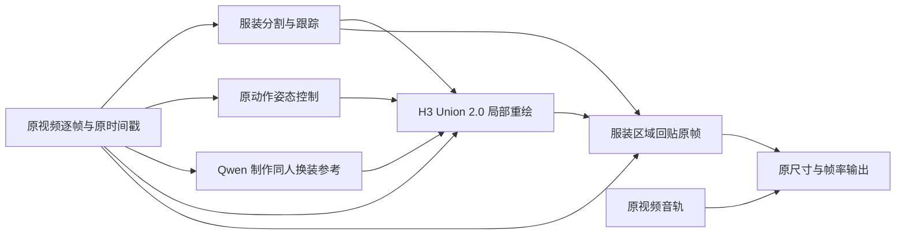

# 测试视频换装：项目工作流与模型可行性分析

检查日期：2026-11-15（Asia/Shanghai）。测试素材：`D:\aigc\test.mp4`。

已按用户后续“你执行吧”的指令运行测试并制作换装视频。实际采用 **Qwen 同人换装参考 → H3 Ref2VA 人物替换 LoRA + Union 姿态控制 → 衣物局部运动修正 → 原视频服装遮罩合成**。下面保留初始分析供核对，最终流程、运行命令和验收结果见 [执行记录](video-clothing-results-2026-11-15.md)。

**实测修正：** 初始建议的 FL2VA + Union 2.0 `mask/source_video` 分支在本素材上首帧正常、后续衣物变黑，未通过小样验收。最终 Union 只用于姿态控制，不连接服装遮罩和源视频局部重绘输入；遮罩在外部合成阶段使用。不要将下文的初始推荐图当作已验证的成片路线。

初始分析完成了媒体信息、抽样画面、项目模板与节点接口、DGX 文件和上游文档检查。当时尚未推理，以下候选及参数描述保留其设计时的语境；后续实测以执行记录为准。

## 1. 测试视频与难点

| 项目 | 检查结果 |
|---|---|
| 画面 | 1080×1920，9:16 竖屏 |
| 视频帧率、帧数 | 30 fps，374 帧 |
| 视频时长 | 12.466667 秒 |
| 容器／音频时长 | 12.467007 秒 |
| 视频编码 | H.264，yuv420p |
| 音轨 | AAC，44.1 kHz，双声道 |
| 文件大小 | 2,821,615 字节 |

抽样画面见 [联系表](../test-results/test-clothing-contact-sheet.jpg)。人物穿宽松深蓝长袖上衣和短裤，主体明确，室内墙面与门构成较简单的背景，没有在抽样中看到换镜头。这些条件适合做初步实验。

难点集中在衣服与人体的边界：宽袖摆动、双臂交叉、手在胸前及脸旁活动、手向镜头伸出，以及衣摆与短裤交叠。每秒抽样不足以发现每个快速动作的问题，实际验收仍需逐帧和正常速度观看。

建议先比较长袖针织、牛仔外套、商务休闲外套等接近原衣服覆盖范围的风格。改成短袖、无袖或明显收腰衣服会需要生成原衣服遮住的手臂／身体；换长裙或大衣则会覆盖原本可见的腿或背景。这些情况下，需要允许扩大衣服修改范围，且不可声称新露出的身体细节来自原视频。

## 2. 已有工作流的适用程度

| 项目中的入口 | 能借用的部分 | 对本任务的限制 |
|---|---|---|
| `h3-union-control` | 原视频读取、Union 2.0 控制、采样与解码 | 最适合作为主图；现图未接服装遮罩，只有 Canny 示例 |
| `h3-character-swap` | 原视频动作 + 目标人物图片，已有服装迁移记录 | 换的是整体人物外观；脸、人体、动作和背景可能漂移 |
| Qwen 图片编辑 | 用源帧制作同一人物、不同服装的参考图 | 单帧编辑不等于视频换装，逐帧独立编辑容易闪烁 |
| `h3-face-refine` | 跟踪裁剪、局部处理、羽化回贴的实现思路 | 为脸设计，不能直接把脸部跟踪节点当服装跟踪器；本任务的脸应直接保留原帧 |
| `h3-sharpen` | 原视频潜变量注入、视频重绘结构 | 当前 `denoise=0.15` 用于增强细节，不能据此保证大幅换装 |
| `h3-head-swap` | 人物外观参考处理 | 目标是换头并保留衣服，与这次目标相反 |
| `h3-motion`／续镜模板 | 时间一致性、参考与分段处理思路 | 自由生成动作或续镜会改变原视频动作，不能直接承担动作保留 |
| `h3-refmod` | 可复用参考数据、遮罩提取参考概念 | `concept_type=clothing` 是元数据标签，不是专门训练的换装算法 |

`docs/11/workflows` 中的 Qwen 编辑图和 H3 图生视频图也可借用参考图制作部分，但 H3 A/B/C 等仍是首帧生成路线，不能依靠“动作背景保持不变”的提示词完成严格视频编辑。

### 最关键的接口发现

DGX 当前源码 `/home/jnu/src/ComfyUI-h3-extended/comfy_extras/nodes_minimax_h3.py` 中，`MiniMaxH3FunControlNetApply` 提供：

- `control_video`：控制视频，可换成与原动作对应的姿态图。
- `mask`：1 表示要重新生成的区域。
- `source_video`：遮罩背后的原视频，**只在传入 mask 时读取**。

源码的 `prepare_control_latent` 将遮罩外的源视频、可见性和控制提示编码成控制条件；这是实质的视频局部编辑接口。现有 `h3-union-control` 虽然连接了 `source_video`，但未连接 `mask`，所以该连接目前不提供局部保留功能。

这仍然是模型条件约束，不是遮罩外像素的硬锁定。因此最后的原帧回贴不可省略。现有 Union 模板的 Canny 生成已经有验收记录，但 **Union 2.0 的服装遮罩分支尚未在本次素材上实测**，需要先检查实际权重和接口组合的短片推理。

相关项目代码：[模板构建器](../aigc/h3_extended.py)、[Union 模板](h3-extended/workflows/h3-union-control.api.json)、[人物替换模板](h3-extended/workflows/h3-character-swap.api.json)、[已有验收记录](h3-extended/validation.md)。

## 3. 模型检查与选型

本次通过现有 `dgx` SSH 配置只读检查。机器是 NVIDIA GB10、Linux aarch64，系统总统一内存约 121.69 GiB；检查当时可用内存约 112.66 GiB。模型文件大小不能当作推理峰值内存，也不能据此承诺全分辨率视频的耗时。

| 资源 | 本次文件检查 | 用途与建议 |
|---|---|---|
| H3 FL2VA INT8 主模型 | 已在，约 19.53 GiB | 优先沿用 Union 模板的主模型组合进行短片测试 |
| H3 Ref2VA INT8 主模型 | 已在，约 19.53 GiB | 人物替换对照路线；不要直接混用不同任务的 Turbo LoRA |
| H3 Union **2.0** INT8 | 已在，约 4.22 GiB | 推荐的局部编辑控制权重；与旧 Union 权重区分 |
| H3 编码器、音视频 VAE、匹配的 LightX2V | 已在 | 复用现有环境，无需一开始替换整套生成模型 |
| Qwen Image 2.1 INT8 + 编码器／VAE | 已在独立 Qwen 环境 | 先制作换装参考图，再释放 Qwen 环境运行 H3 |
| SDPose wholebody | 已在，约 1.79 GiB | 从原帧提取姿态约束，减少旧衣服纹理对生成的影响 |
| `person_yolov8m-seg.pt` | 已在 | 分割整个人；不能直接产生只含衣服、排除手脸的遮罩 |
| SAM3 视频分割与跟踪节点 | 当前源码存在，历史 `/object_info` 中已注册 | 可复用 `SAM3_Detect`、`SAM3_VideoTrack`、`SAM3_TrackToMask` |
| SAM／SAM2／SAM3 分割权重 | 检查的 ComfyUI 模型目录与 `/home/jnu/models/aigc` 范围未找到 | 需补齐与当前加载器兼容的分割权重；文字分割还需核对文本编码资源 |
| Wan VACE／Wan Animate 权重 | 同一检查范围未找到 | 属于新增模型候选，不是已经可直接运行的项目能力 |

主路线最明显的资源缺口是服装分割和跟踪。优先检查当前原生 SAM3 加载器所支持的具体权重组合，用“上衣／短裤”文字或首帧人工遮罩辅助分割，并在遮挡处修正。SAM3 是可提示分割模型，不保证一次就把袖子、手和衣摆分对。SAM2.1 可作为另一种带首帧提示的视频跟踪方案，需要额外接入工具或脚本。

不要仅因模型名称新就更新整个 H3 环境；尤其不能把 SAM3.1 权重默认当作当前 SAM3 实现的直接替换品。Linux ARM64 的 Torch／CUDA、节点加载器和可选算子需按实际环境核对。

另外，项目中的 `Character Clothing` 节点只输出服装描述字符串，不能完成分割、换装或视频生成。RefMod 的 `clothing` 标签也不能当作服装 LoRA 使用。

## 4. 推荐的工作流改造

1. **保持原时间轴。** 解码全部 374 帧并记录时间戳、30 fps、原音轨。各阶段按源帧索引对应，不先把视频重新生成成另一套动作。
2. **制作换装参考。** 从原视频选衣服清楚的源帧，用 Qwen 只编辑服装。每种风格固定一套颜色、材质、领口和袖口，必要时补充抬手或侧身参考。将原脸、头发和背景回贴到编辑参考中，避免把单帧编辑漂移传播给视频。参考图需要人工视觉检查。
3. **取得逐帧服装遮罩。** 区分上衣、短裤和保护区域，排除脸、头发、颈部、可见手部、腿部等不需改变的区域。快速遮挡处要检查遮罩是否漏袖子或误包含手。
4. **区别生成遮罩和合成遮罩。** 生成遮罩可适度扩大，覆盖原衣服边缘、旧标志和目标衣服可能占据的范围；合成遮罩应限制最终修改范围，并再次排除保护区域。羽化范围仍属于允许改变的范围。
5. **接通 Union 的局部重绘输入。** `source_video` 接原帧，`mask` 接生成遮罩，`control_video` 优先接原视频姿态。从现有 FL2VA + Union 2.0 组合开始，使用换装后的首帧／参考条件。若改用 Ref2VA，需要单独验证相应模型、LoRA、参考条件和 Union 的组合。
6. **避免保留旧衣服纹理的控制。** 默认 Canny 会保留胸前大号数字、原衣服边线和皱褶，可能阻碍换装。优先比较姿态控制；需要轮廓时，移除服装内部旧纹理或只保留必要轮廓。
7. **只把服装结果回贴原帧。** 使用 `ImageCompositeMasked` 等节点或外部合成器。人脸、手、背景来自同一时刻的原帧，衣服来自生成帧；必须先检查衣服与原身体位置是否对齐，不能靠合成掩盖位置漂移。
8. **输出全部原帧并保留原音轨。** 最终恢复 1080×1920、30 fps、374 帧，裁去模型网格所需的补帧。用原 AAC 音轨封装，若要保留原音频编码数据则采用音频流复制，不使用 H3 新生成的音轨。

合成可以表示为 `输出帧 = M × 生成帧 + (1−M) × 原帧`。对于 `M=0` 的区域，合成前的像素可直接保持来自原帧。常规 H.264 重新编码仍会带来像素误差；如需校验严格不变，应在无损合成帧上检查，保留 PNG／FFV1 中间结果，不能承诺最终有损 MP4 的每个像素与原文件解码结果相同。

这条路线能限制外貌和背景变化；衣服本身的摆动、皱褶、手臂遮挡和时间一致性仍依赖生成质量。换成不同轮廓的服装时，需要覆盖原衣服与新衣服的共同变化范围，而不是只涂原上衣内部。

### 必须一起调整的现有默认参数

- 当前 `VHS_LoadVideo` 默认 `force_rate=24`、`frame_load_cap=124`，一般只处理约 5.17 秒；这不能直接处理测试视频的全部 12.47 秒。
- 当前图常用 512×320 横屏，测试素材是竖屏；直接套用可能裁切或改变构图。竖屏预览可先比较 288×512，质量实验可考虑 576×1024，均保持 9:16 和 32 的尺寸倍数。参数只是实验起点，不是质量承诺。
- H3 长度需按 `5+17k` 对齐。374 帧若作为单窗口输入，需要补至 379 帧并在输出裁去 5 帧；不建议首轮直接跑全片。分窗口也应各自对齐，并保留源帧索引。
- 对 30 fps 输入需做小样核对。若内部必须采用 24 fps，应显式按时间戳将衣物结果映射回原 30 fps；不能只把输出 fps 改成 30，否则会改变动作速度和时长。
- 原生模板通常使用模型生成的音频；本任务应改为原音轨。其他阶段也不能重生成台词或音乐。
- 多窗口应共享服装参考，并用重叠帧和已有生成结果约束接缝；只设置相同随机种子不能保证衣服纹理一致。H3 的自由续镜不等于对原视频后续帧的编辑。

## 5. 若现有 H3 路线达不到质量要求

| 候选 | 上游明确提供的能力 | 对这次任务的定位 |
|---|---|---|
| Wan2.1-VACE-14B | 视频 + 遮罩 + 参考图的 masked video-to-video 编辑 | 比较值得新增测试的局部视频编辑模型；仍需要服装遮罩、原帧合成和时序验收 |
| Wan2.1-VACE-1.3B | 同类接口，较小模型 | 用于检查新流程；其细节质量需单独比较，不能等同 14B |
| Wan2.2-Animate-14B replacement | 人物参考、动作、表情、背景和遮罩材料驱动人物替换 | 值得作人物替换对照；默认替换整个人，不能当作只换服装的专用模型 |

Wan 官方现有版本支持这些路线，但本项目检查范围内未部署对应权重。新增时需要完整匹配的主模型、编码器、VAE、预处理及加载器；现有 H3 或 Qwen 的权重不能直接替代它们。GB10 上的实际内存、ARM 算子兼容性和速度应由短片测试决定。

## 6. 建议的验证顺序与验收条件

先为三种接近原覆盖范围的上衣风格制作静态参考，再测试一段约 2–3 秒的普通动作和一段包含交叉手臂／伸手动作的片段。比较“现有 H3 人物替换”和“Union 2.0 服装遮罩局部重绘”；两条路线都应回贴原帧后比较，以判断衣物位置和边缘是否对齐。

第一轮需要确认：遮罩接口与权重组合实际可运行、旧图案完全移除、手脸未被服装覆盖、衣物跟随原动作、边缘没有原衣服残留或拖影。随后才运行全片，检查窗口接缝、闪烁、颜色／图案漂移，以及视频帧数、时长、尺寸、音频是否与原片对应。

“流程生成成功”与“效果满足只换服装”是两项验收。现有项目的人物替换样片已支持服装迁移的可行性，但不证明本视频已达到目标。当前最合理的工程顺序是补齐服装跟踪、接入 Union 遮罩、实现原帧合成，再根据实际画质决定是否增加 VACE。

## 7. 证据与上游资料

- 本次只读资源与源码摘录：[DGX 检查结果](../test-results/video-clothing-analysis/remote-audit.json)。这是文件检查与相关接口检查，没有加载模型。
- 历史节点接口：`test-results/h3-extended/dance297-inspection/object-info.json`。本次同时读取当前 DGX 核心源码核对 Union 和 SAM3 接口；本地 8766 工作台检查时未运行，没有取得新的在线 `/object_info` 或推理验收。
- 项目模型与已有验收：[H3 部署](h3-extended/deployment.md)、[H3 验收](h3-extended/validation.md)、[Qwen 部署](qwen21/deployment.md)。
- [SAM3 官方](https://github.com/facebookresearch/sam3)：图像和视频的文字／视觉提示分割与跟踪。当前 SAM3.1 更新不能自动视为已部署。
- [SAM2 官方](https://github.com/facebookresearch/sam2)：带点、框和遮罩提示的视频跟踪。
- [VACE 官方](https://github.com/ali-vilab/VACE)：masked video-to-video、参考图与遮罩输入。
- [Wan2.2 官方](https://github.com/Wan-Video/Wan2.2)：Animate 人物动画与替换。

上游 README 副本保存在 `test-results/video-clothing-analysis/`，供后续核对。后续下载应固定模型及代码版本，避免把当前文档和旧环境混用。
