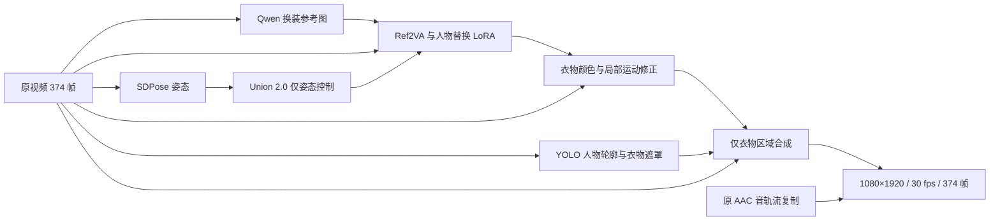

# test.mp4 换装执行记录

开始日期：2026-11-15；完成日期：2026-11-16（Asia/Shanghai）。源文件为 `D:\aigc\test.mp4`，单人、深蓝球衣与短裤、室内固定场景。用户已授权实际执行。

## 实际方案

复用项目中已有的 Qwen Image 2.1 和 H3 扩展环境，没有新增下载视频主模型。三套参考服装为米白针织、浅蓝牛仔、炭灰商务休闲，均保持原来的长袖和短裤覆盖范围。



初始分析建议的 `FL2VA + Union 2.0 + mask/source_video` 分支已实际测试：首帧正常，后续衣物变黑，因此排除。`Ref2VA + character_swap` 可以连续迁移衣物，但衣物轮廓会偏移。最终加入姿态控制，再使用原视频光流修正衣物内部错位区域，并把衣物合成到同一时刻的原画面。

最终 Union 控制节点 **不连接 `mask` 和 `source_video`**。服装遮罩只在外部修正与合成中使用。只运行人物替换 API 图会产生整体人物替换结果，不能将其单独当成“脸、手、背景完全保留”的最终工作流。

## 模型与参数

| 资源 | 实际使用 |
|---|---|
| 单帧参考 | 已部署 Qwen Image 2.1 INT8、25 步 |
| 视频主模型 | `minimax_h3_ref2va_pruned_int8_convrot.safetensors` |
| 加速 LoRA | `minimax_h3_ref2v_lightx2v_turbo_4step_v0.1_resized_avg_rank_20_bf16.safetensors` |
| 人物替换 LoRA | `minimax_h3_character_swap_v1.1_ref2va_fro.safetensors` |
| 姿态控制 | `minimax_h3_fun_controlnet_union_2.0_pruned_int8_convrot.safetensors`，强度 0.65，结束比例 0.85 |
| 姿态提取 | 项目既有 SDPose wholebody |
| 人物轮廓 | 项目既有 `person_yolov8m-seg.pt` |
| H3 输出 | 576×1024、30 fps、4 步、seed 42 |
| 分段 | 起始帧 0 / 102 / 204 / 306；前三段各 124 帧，末段模型生成 73 帧、保留 68 帧 |
| 重叠 | 22 帧渐变；下一窗口参考由上一窗口对应帧与原帧合成 |
| 最终文件 | H.264、1080×1920、30 fps、374 帧；原 AAC 流复制 |

针织前两段使用 576×1024 动作参考，后两段及另外两套使用 288×512 动作参考。所有段的衣物输出与姿态控制仍为 576×1024，按原时间轴生成。缩小参考是计算优化，不是把衣物或动作降到 15 fps。

衣物遮罩结合蓝色原服装、邻近号码和袖章、YOLO 人物轮廓、SDPose 的脸与手、关联皮肤区域。保护实际可见皮肤，取消向相邻衣物扩张的保护边界，减少手部周围原深蓝衣服的残边。模型可能在衣物内部生成原背景或额外皮肤，后处理使用参考图颜色簇检测这些区域，以原视频 DIS 光流搬运前一帧衣物，必要时局部填补。衣物颜色校正保留布料的局部明暗。

## 文件与复现

工作目录：`D:\aigc\data\clothing\test-20261115`。

- `source.json`：原尺寸、帧率、374 个时间戳。
- `frames/`、`masks/`：按原帧索引保存的工作帧与服装遮罩。
- `references/knit.png`、`denim.png`、`business.png`：回贴原脸和背景的换装参考。
- `pose.json`、`pose-work.mp4`、`person-mask.mkv`：姿态与人物分割材料。
- `results/{style}/window-*/workflow-api.json`：逐窗口实际提交图，另有任务历史、SHA-256 校验归档和生成视频。
- `results/{style}/cloth-frames/`：重叠处理后的衣物帧，可重新后处理而无需模型推理。
- `results/{style}.mp4`：最终完整视频；对应 `.validation.json` 保存合成与媒体检查结果。
- `results/comparison.mp4`：原视频、针织、牛仔、商务休闲的 2×2 同步对比。
- `results/review.json`：全部输出的帧数、尺寸、音频 packet hash 和文件 SHA-256。

在已有 `.venv` 中安装额外依赖；本地需要 `ffmpeg` 与 `ffprobe` 在 PATH，远端沿用项目既有 DGX/ComfyUI 模型环境：

```powershell
.\.venv\Scripts\python.exe -m pip install -r requirements-clothing.txt
.\.venv\Scripts\python.exe -m aigc --port 8766
```

本次新增 SDPose 输出辅助节点，以及 H3 `checkpoints` 模型类别登记，解决姿态加载器模型列表为空的问题；远端原配置已备份。辅助节点部署命令为：

```powershell
.\.venv\Scripts\python.exe scripts/deploy_clothing.py
```

针对这段素材完整运行（按存在的准备文件跳过准备；有相同 API 图的完整窗口则复用）：

```powershell
.\.venv\Scripts\python.exe -X utf8 scripts/video_clothing.py run --source D:\aigc\test.mp4 --styles knit denim business --method character-pose --width 576 --height 1024 --steps 4
```

已有准备材料时，只生成视频可改用 `full`。只重建已保存窗口并重新合成，不连接服务器：

```powershell
.\.venv\Scripts\python.exe -X utf8 scripts/video_clothing.py compose-full --styles knit denim business
.\.venv\Scripts\python.exe -X utf8 scripts/review_clothing.py --compare
```

断点重建会从首段重新写入衣物帧，仅对当前段与前一段的真实重叠做渐变，不把旧运行留下的帧当作新的重叠。此行为已加入回归测试。若改变素材，请使用新的 `--out` 目录；遮罩算法针对本测试视频，不能直接宣称适用于任意衣物颜色和背景。

音频采用视频编码完成后的独立流复制封装。实测发现同时输入原音轨并用 `-frames:v 374` 限制原始帧编码，会漏掉末尾一个 AAC 包；独立封装后，原音频的所有 packet 字节 SHA-256 完全一致。旧编码结果可用 `scripts/review_clothing.py --restore-audio` 修复，视频流不重新编码。

## 验收与限制

三套完整输出与同步对比视频已生成，媒体检查全部通过。每版均为 1080×1920、30 fps、374 帧，视频时长 12.466667 秒，原 AAC 的全部 packet SHA-256 一致。合成遮罩之外编码前像素差为 0。逐文件校验值、模型窗口耗时和抽检联系表见 `results/review.json`。本地 86 项测试通过，包括新增的缓存重建幂等性与重叠范围回归检查，新增脚本也通过 `py_compile`。

| 完整结果 | H3 四窗口推理合计 | 验收 |
|---|---:|---|
| [米白针织](../data/clothing/test-20261115/results/knit.mp4) | 约 23.77 分钟 | 全帧、尺寸、帧率、原音轨与校验值通过 |
| [浅蓝牛仔](../data/clothing/test-20261115/results/denim.mp4) | 约 13.37 分钟 | 同上 |
| [商务休闲](../data/clothing/test-20261115/results/business.mp4) | 约 12.97 分钟 | 同上 |
| [2×2 同步对比](../data/clothing/test-20261115/results/comparison.mp4) | 本地封装 | 全帧与原音轨通过 |

这些耗时是本机这次四窗口记录的合计，不含参考制作、预处理、小样实验、下载、合成及检查，不是未来耗时保证。推理结束后，已通过工作台正常断开 DGX，会话清理返回 `cleaned=true`；本地视频和工作流保留。

合成使用 `输出 = M × 衣物 + (1−M) × 原帧`，在 `M=0` 区域编码前像素差为 0。脸、手、可见腿部和背景来自原视频；衣物与边缘羽化范围采用生成层。最终 H.264 为有损编码，不能把编码前的区域保留等同于最终 MP4 每个解码像素完全一致。

视觉抽检覆盖手部遮挡、伸手动作、三个重叠区和结尾。当前结果属于换装测试版：针织存在光泽与纹理漂移，牛仔纹理局部偏软，商务版后半段白色内搭有黑白纹理漂移；袖口、衣摆和快速遮挡处仍有边缘瑕疵。姿态与局部光流修正不能完全解决衣物材质和形状的一致性。媒体检查通过不等于无瑕疵换装。若要求商业级精细边缘，后续可考虑更精确的视频服装分割、人工遮罩修补或比较 VACE 路线。
